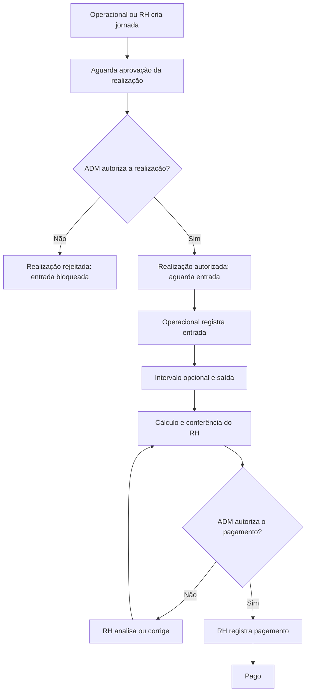

# DEC-001: duas aprovações independentes do Administrador

Data: 22/10/2026.

Situação: **aceita como regra de produto**.

Origem: instrução explícita do responsável pelo projeto nesta conversa: a jornada deve ser autorizada pelo ADM após sua criação, para poder ocorrer; depois de concluída, deve receber nova autorização para que seu pagamento seja efetuado.

Implementação: **concluída no código em 24/10/2026**, com migração local, testes HTTP e integração MySQL. Homologação manual no aplicativo e recebimento push em aparelho permanecem pendentes, sem invalidar a entrega de código. Detalhes e evidências em [DEC-004](DEC-004-IMPLEMENTACAO-DUPLA-APROVACAO.md) e no [guia técnico](../../back/docs/jornadas-aprovacoes.md).

## Contexto e problema

O fluxo do artigo e do código anterior cria a jornada diretamente em andamento. O ADM só decide depois do encerramento e da conferência pelo RH. Esse controle autoriza o pagamento, mas não autoriza previamente a realização do serviço.

O responsável esclareceu que são necessárias duas decisões com finalidades e momentos diferentes. A autorização da realização precisa existir antes do início do trabalho; a autorização de pagamento precisa avaliar a jornada efetivamente realizada.

## Decisão de produto

1. Operacional ou RH cria a jornada com seus dados de planejamento.
2. A jornada aguarda decisão do Administrador para sua realização. A criação não libera a entrada.
3. O Administrador autoriza ou rejeita a realização. Somente a autorização prévia libera o início dos eventos operacionais.
4. Operacional registra entrada, eventual intervalo e saída, respeitando a ordem e as validações temporais existentes.
5. O encerramento calcula horas e valor e encaminha a jornada à conferência do RH.
6. Depois da conferência, o Administrador decide novamente, agora para autorizar ou rejeitar o pagamento da jornada efetivamente realizada.
7. Somente após a autorização de pagamento o RH pode registrar a quitação.

A conferência do RH existente é preservada. O usuário exigiu uma nova decisão inicial; não pediu a remoção da conferência administrativa.

## Fluxo visual

O caminho de correção pressupõe horários encerrados e nova conferência. Rejeição prévia não segue o caminho de correção de horários de uma jornada já executada.

## Invariantes obrigatórios

- Criada não significa autorizada; autorizada para realização não significa em execução; entrada é o início efetivo.
- Não registrar entrada, intervalo ou saída sem autorização prévia válida para a realização.
- A primeira aprovação não autoriza pagamento, e a segunda não regulariza retroativamente execução sem aprovação prévia.
- Decisões do ADM e conferência do RH continuam separadas. RH ou Operacional não podem se autoaprovar como ADM.
- A aprovação de pagamento deve se referir aos horários e valores finais conferidos.
- Correções posteriores ao encerramento invalidam a aprovação de pagamento da versão anterior e exigem nova conferência e decisão, preservando a autorização de realização e o histórico.
- Preservar separadamente autor, instante, resultado e justificativa de rejeição de cada etapa. Uma decisão não pode sobrescrever a outra.
- Cada alteração relevante deve registrar auditoria com estado anterior e posterior, na mesma transação.
- Eventos e decisões repetidos ou concorrentes não podem criar duplicidade ou ultrapassar etapas.
- Pagamento permanece registro de quitação; não executar transferência bancária.

## Proposta técnica para implementação

Os nomes a seguir são **propostos**, não representam estados já existentes nem uma exigência literal do usuário:

| Etapa | Estado sugerido | Próxima ação |
| --- | --- | --- |
| Criada | AGUARDANDO_AUTORIZACAO_REALIZACAO | ADM decide sobre a realização |
| Realização rejeitada | REALIZACAO_REJEITADA | Revisão/novo envio conforme política a definir |
| Realização aprovada | AUTORIZADA_PARA_REALIZACAO | Operacional registra entrada |
| Entrada registrada | EM_ANDAMENTO | Operacional registra eventos até saída |
| Encerrada | AGUARDANDO_CONFERENCIA | RH confere ou corrige |
| Conferida | AGUARDANDO_AUTORIZACAO_PAGAMENTO | ADM decide sobre pagamento |
| Pagamento rejeitado | PAGAMENTO_REJEITADO | RH analisa/corrige e confere novamente |
| Pagamento autorizado | PAGAMENTO_AUTORIZADO | RH registra quitação |
| Quitada | PAGO | Consulta e histórico |

Evitar rótulo genérico "Autorizado" para duas finalidades diferentes. Se forem preservados os nomes internos AUTORIZADO e REJEITADO para a etapa de pagamento por compatibilidade, deixar sua finalidade explícita na API, na interface, na documentação e nos relatórios.

Separar dados da decisão de realização dos dados da decisão de pagamento. Não reutilizar `decidida_por`, `decidida_em` e `justificativa_rejeicao` de modo que a segunda etapa apague a primeira. Definir novas colunas ou entidade de decisões versionadas na implementação, conciliando dicionário e diagrama.

## Migração e registros existentes

- Não recriar o banco para implantar a mudança.
- Não preencher aprovação prévia fictícia em jornadas antigas. A ausência desse registro é um dado histórico.
- Estados antigos de autorização/rejeição referem-se ao pagamento; não convertê-los em autorização prévia da realização.
- Separar jornadas antigas sem entrada das já iniciadas/encerradas. Definir tratamento explícito para legado e data de vigência antes de aplicar a migração.
- Preservar registros pagos, cálculos e auditoria. Registrar qualquer mapeamento de estado e validar relatórios após a migração.

## Questões em aberto

**Atualização de 24/10/2026:** os pontos abaixo registram o planejamento inicial. Foram resolvidos na implementação conforme DEC-004: cancelamento/recriação em vez de edição prévia, legado explícito, cancelamento antes de marcações e uma reserva aberta por prestador. Não tratar esta lista histórica como bloqueio atual.

Estas políticas não foram definidas na instrução original e precisam ser resolvidas antes das partes correspondentes da implementação:

- Quem pode editar e reenviar uma jornada cuja realização foi rejeitada? É necessário novo registro ou nova versão da mesma jornada?
- Quais mudanças de planejamento após aprovação exigem nova autorização da realização? Proposta: mudança de prestador, data, função, setor ou valor/hora antes da entrada deve invalidá-la.
- Como tratar jornadas legadas iniciadas sem aprovação prévia, sem inventar aprovação retroativa?
- Em quais novos estados o cancelamento sem marcações é permitido?
- Como detectar conflito entre jornadas pendentes/autorizadas, preservando a restrição existente de uma jornada efetivamente em andamento por prestador?

Esses detalhes não suspendem a decisão principal de exigir duas aprovações.

## Critérios de aceite

1. Jornada recém-criada não oferece nem aceita eventos antes da aprovação de realização, inclusive por chamada direta à API.
2. Somente ADM ativo pode aprovar/rejeitar cada etapa; justificativas são exigidas nas rejeições.
3. Aprovação inicial permite entrada, mas não conferência antecipada nem pagamento.
4. Entrada muda a jornada para execução; saída calcula resultados e aguarda conferência.
5. Jornada encerrada/conferida ainda exige segunda decisão explícita do ADM para pagamento.
6. Rejeição e correção do pagamento não apagam a primeira decisão nem seu histórico.
7. Operações concorrentes, repetidas ou fora de sequência são rejeitadas sem gravação parcial.
8. Painéis, filtros e relatórios distinguem pendência de realização e pendência de pagamento.
9. Migração preserva dados, evidencia a situação legada e não cria aprovações fictícias.
10. Testes, API, interface, banco, documentação e memória representam o mesmo ciclo.

## Impactos documentais

Revisar RF02, RF05, RF06, RF11, RF14, RF15 e RF16; reavaliar RF12/RF13 e as regras RN02, RN06-RN08, RN10 e RN13-RN19. Atualizar máquina de estados, campos de decisão, fluxos alternativos, protótipos, casos de teste e diagrama. A lista é um mapa de impacto, não uma renumeração já aprovada dos requisitos.

O artigo original permanece como documento histórico de pré-banca. Esta decisão o complementa e substitui a interpretação de que há somente uma autorização do ADM ao final. Uma versão revisada do artigo deve incorporar a nova regra explicitamente.
